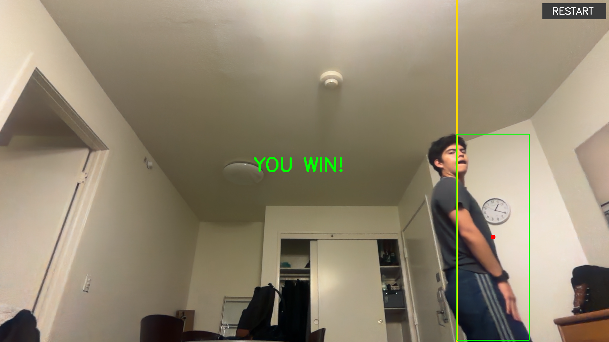
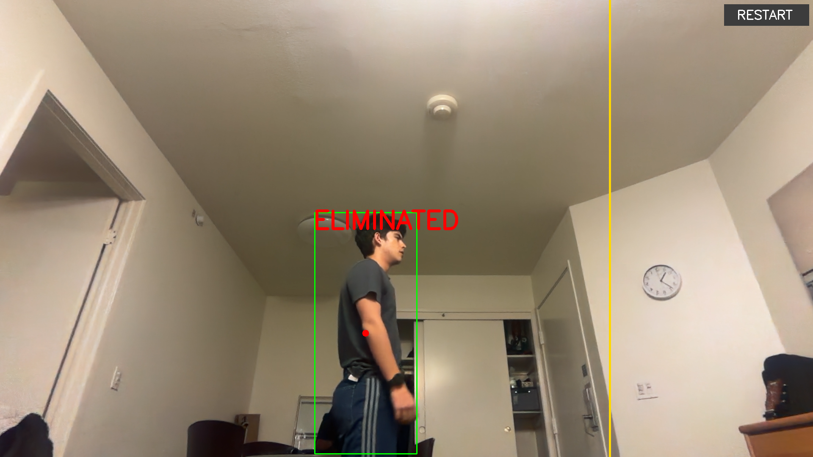

# Red Light, Green Light 🚦

So, this is a small game that uses the webcam and object detection. I use a pretrained YOLO model whose job here is to find the player live in the camera feed, and the game turns that detection into the classic, simple game of Red Light, Green Light: if the camera catches you moving, you lose.

Also, the computer announces everything out loud, so technically you can play using only the sound, without looking at the screen.

## Demo

| Win | Elimination |
|---|---|
|  |  |

- Demo video: [`samples/demo.mp4`](samples/demo.mp4)
- Example event log from real games: [`samples/events.log`](samples/events.log)

## What it detects

The program detects **people** (COCO class 0, `person`) in a live webcam feed. It is a single-player game: on each frame, the highest-confidence person detection is treated as the player.

## Which model and why

**YOLOv8n** (the "nano" version), pretrained on the COCO dataset, through the `ultralytics` library.

- **Accuracy where it matters.** `person` is one of the best-represented classes in COCO, so detection is reliable without any fine-tuning. While standing still, the center of my bounding box moved only a few pixels between frames, which is what makes a strict movement threshold fair.
- **Speed.** The nano model is ~6 MB and runs in real time on a laptop CPU, which a game needs.
- **Focus on the logic.** Using a pretrained model let me spend my time on the part that makes this project interesting: the game rules built on top of the detections.

### Design note: why a game and not a focus tracker

My first idea was a kind of focus tracker: something that watches you while you study and, if it sees you using your phone, detects it and warns you. That idea changed pretty quickly, though, because the laptop camera couldn't see the phone on the desk. So I went for something that's easier for a laptop camera to see and that actually looks good on screen: a person moving across the frame seemed perfect for that, and yeah.

## How the code processes input and detections

Everything happens in one loop in `redlight.py`. On every frame:

1. **Read a frame** from the webcam and mirror it horizontally, so moving right on screen feels like moving right in real life.
2. **Run YOLO** on the frame, restricted to the `person` class with a confidence threshold of 0.5.
3. **Handle no detections.** If nobody is detected, the screen shows "No player", the start countdown resets, and the game rules are skipped for that frame. The program never accesses a box that doesn't exist, so it never crashes when the player leaves the frame.
4. **Extract the player.** Otherwise, it takes the top detection's bounding box `(x1, y1, x2, y2)` and computes the horizontal center `center_x = (x1 + x2) / 2`. This single number is what the game logic uses to locate the player.
5. **Update the game state machine** (below), draw the overlay, save a screenshot if something important happened, and check for keyboard and mouse input.

The start box and finish line are defined as fractions of the frame width (25% and 75%), so the layout works on any camera resolution.

## Custom behavior: the game logic

The game is a state machine with four states:

| State | What happens | Transition |
|---|---|---|
| `WAITING` | A START box is drawn on the left 25% of the screen. | Player's center stays inside the box for 2 seconds → `PLAYING` |
| `PLAYING` | Lights switch between GREEN and RED at random intervals, announced out loud. | Moves during RED → `ELIMINATED`; center crosses the finish line → `WON` |
| `ELIMINATED` | Big red text, voice says "Eliminated", screenshot saved. | Restart → `WAITING` |
| `WON` | Big green text, voice says "You win", screenshot saved. | Restart → `WAITING` |

Key details:

- **Start box.** The player launches the program from the laptop, so they need time to walk into position. The game only starts once the player has held still inside the START box for 2 seconds; leaving the box resets the countdown.
- **Random timing.** GREEN lasts 1–2 seconds and RED lasts 2.5–4.5 seconds, chosen randomly each time, so the player can't predict the switch. Green is short so the course takes several rounds to cross.
- **Grace period (reaction time).** After "RED light" is announced, the player has 1.5 seconds before movement counts. This covers the time for the voice to start, the words to be spoken, and a human to react and stop. Without it, players were eliminated for a step they had already started.
- **Movement detection.** After the grace period, the player's position is saved as a reference (`frozen_x`). On every following frame, if `|center_x - frozen_x|` exceeds 20 pixels, the player is eliminated. The threshold sits well above YOLO's frame-to-frame jitter, so only real movement counts.
- **Rule order.** Elimination is checked before winning, so sprinting across the finish line during RED gets you eliminated, not a win.
- **Voice.** Uses the built-in macOS `say` command in the background, so the video never freezes. On other operating systems the game runs silently instead of crashing.
- **Event log.** Every start, light change, elimination (including how many pixels the player moved), win (including the time taken), and restart is printed with a timestamp and appended to `output/events.log`.
- **Auto screenshots.** The frame is saved to `output/` the moment the player wins or is eliminated, after the overlay text is drawn.
- **Restart.** Click the on-screen RESTART button or press `r` to go back to `WAITING`.

All tuning values (light durations, grace period, threshold, zone sizes, voice speed) are constants at the top of `redlight.py`.

## Installation and running

Requires Python 3.9+ and a webcam. Tested on macOS with Python 3.9.6.

```bash
git clone https://github.com/HambuP/red-light-green-light.git
cd red-light-green-light
python3 -m venv .venv
source .venv/bin/activate        # Windows: .venv\Scripts\activate
pip install -r requirements.txt
python redlight.py
```

The YOLOv8n weights (`yolov8n.pt`) download automatically on the first run.

On macOS, allow camera access for your terminal or editor in **System Settings → Privacy & Security → Camera**.

### How to play

1. Stand about 2 meters from the camera, with room to walk sideways.
2. Walk into the START box on the left and hold still for 2 seconds.
3. Move right during GREEN LIGHT, freeze during RED LIGHT.
4. Get your center (the red dot) past the yellow finish line to win.
5. Click **RESTART** or press `r` to play again; press `q` to quit.

## Limitations

- **Single player.** The highest-confidence person is the player. A second person in view could be picked up instead.
- **Only horizontal movement of the box center is checked.** Moving your arms or crouching without shifting your center can go unnoticed.
- **Leaving the frame isn't penalized.** If the player is not detected during RED, no movement check happens.
- **Pixel thresholds depend on distance.** Standing closer makes the same movement larger in pixels, which makes the game stricter.
- **The player must not be too close.** If the bounding box is very wide, it gets cut off at the edge of the frame and the center can't reach the finish line.
- **Voice is macOS-only.** On other systems, the game runs without sound.

## Improvements I would make

- Use **YOLOv8-pose** keypoints to detect movement of individual limbs, not just the box center.
- Make the movement threshold relative to the size of the bounding box so it doesn't depend on distance from the camera.
- Add **multiplayer** using YOLO's built-in tracking IDs, with a separate state for each player.
- Use a cross-platform text-to-speech library so the voice works on every OS.
- Count disappearing from the frame during RED as movement.
- Add difficulty levels that shorten green lights over time.

## Development note

I built this with help from Claude, which wrote and explained the code step by step while I learned how each part works. The design decisions were mine and came from testing: switching from a phone tracker to a game when I realized the webcam can't see my desk, walking sideways instead of toward the camera, the start box, the reaction-time grace period, the restart button, and tuning the difficulty by actually playing it.
